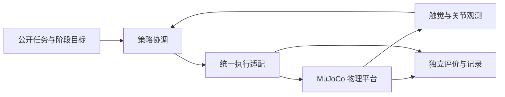

# 架构与项目导航

本项目把抓握任务看成一个连续过程：拿取物体、持握运输、应对扰动、接触接收面并放下。研究目标是让任务完成与受力品质一起进入决策，减少“运动已经结束但仍在补力”或“准备卸力时仍强行维持抓握”等目标冲突。

## 1. 一条共同的闭环

控制器使用允许获取的触觉、关节状态和公开任务信息。物理平台负责接触、运动及扰动；独立评价读取仿真真值，用于判断滑移、掉落、超力和任务完成。保存真值便于事后评价，不意味着这些信息都能供在线策略使用。

当前方案使用五指协同控制及有限的升降、腕部动作接口。它没有扩展成完整手部全部关节的统一 21 维优化，也未接入实物硬件。

## 2. 基线和宏观策略分别做什么

| 环节 | 力比 PI 基线 | 宏观策略 |
|---|---|---|
| 抓持建议 | 根据剪力/法向力关系、滑移反馈调节抓力 | 使用相同来源的抓持建议 |
| 持握与运输 | 依照基线控制与任务执行流程推进 | 把抓持、支撑需求、运动目标、动作权限与力预算共同协调 |
| 接近接收面 | 使用比较版本中定义的接近流程 | 利用公开几何和接收面信息，按剩余间隙提前减速 |
| 触台后交接 | 使用对应基线的释放/交接流程 | 接收面承载后退出持握补力，共同处理卸力、低运动和撤离 |
| 实际执行 | 公共执行接口和机械限制 | 同一接口和限制，一次提交协调后的动作 |

力比 PI 是文献原理的迁移实现。它既包含摩擦比参考，也处理滑移及执行限制，因此应按源码中的真实定义介绍基线。

多任务融合体现在**同一次动作选择同时处理几个任务要求**，而非仅把多个控制器的输出相加。持握、运输和交接各有主目标，但仍共享观测、力预算和执行状态。某一阶段转移执行权后，上一阶段的补力动作不应继续与之竞争。

## 3. 当前宏观版的三个机制

### 抓持与运动共同协调

`midterm_core_v1/` 保留持握阶段的共同任务问题：力比 PI 提供抓力建议，协调层结合支撑需要、运动目标和执行范围形成最终动作。实际执行回执用于区分“计划动作”和“真正执行的动作”。

### 接触前按间隙减速

接近接收面时，根据公开触觉几何、名义胶囊模板和已声明接收面估计间隙，以一条单调规则降低接近速度。几何未知时记录该状态，回到原接近请求。该模块的定位是降低接触冲击；是否降低首峰、是否增加总时间，均需从配对记录中评价。

### 触台后协调卸力与撤离

接收面载荷参与交接判断。进入交接后，持握补力退出；卸力、避免继续向内挤压、低运动与撤离在共同动作空间中处理。完成离开接触还需要持续的清离判断，不能仅以某个采样点的触觉为零判定任务结束。

宏观版省去了部分后续细化，例如转腕提前补偿、轻压载荷变化预测、退出路径记忆和追加升降。转腕、轻压及多轮细化代码仍可供研究，但这些扩展能力和历史版本的收益不自动归属于宏观版。

## 4. 全程控制与共同准备的区别

`cold_start_take_v1/runtime.py` 定义 `ColdStartBaseline` 和 `ColdStartMacro`，从首次观测开始分别调用两种策略；共同任务生成器只提出公开的拿取/升降请求，不直接替代策略写入执行器。这样可以检查从拿取到放下的全过程差异。

旧接管实验先用公共准备流程形成抓持，再在约定状态交给各策略。它适合比较接管后的行为，但抓取准备阶段属于共享控制。两个实验设计都保留于源码中；新实验必须明确选择哪一种，不能用接管后的差异代表此前所有阶段。

发布副本的 `public_runtime/` 为当前全程控制提供新的运行入口，读入随包保留的必要运行模型和参数，在新输出目录中保存配对记录。它不读取旧成绩作为前置条件，也不把缺省的历史证书解释为已通过验收。

## 5. 数据仿真与画面仿真如何对应

本仓库的“数据型仿真”通常是同一物理模型在无交互窗口条件下批量推进，输出力、位姿、命令、阶段和评价数据。它不是只画预先设计的力曲线。

| 层次 | 平台 | 用途 |
|---|---|---|
| 早期环境探针 | `local_probe` 的接触与 Allegro 示例 | 检查模型加载、动力学推进及渲染环境 |
| 双夹爪原型 | `抓握交互仿真` | 检查简化抓持、扰动和浏览器交互 |
| 完整 Shadow 五指原型 | `五指假肢抓握仿真` | 展示手部几何、抓握和接触，使用原型控制逻辑 |
| 早期 Shadow 比较 | 两轮 `多任务融合` 项目 | 批量运行多个控制器、场景和随机种子 |
| 简化五触点基准 | `统一人工反射重构` | 在清楚的动作和观测边界下验证统一协调思想 |
| 完整五指适配 | `五指策略接入_2026-11-03` | 把策略建议映射到实际手部动作，并记录共同观测 |
| 当前任务研究 | `多任务联合控制研究_2026-11-03` | 持握、运输、交接及扩展任务的闭环研究 |

`tools/archived_visualization/` 另保存同步对照视频、全程力曲线和阶段曲线的制作脚本，作为历史制作方法参考。它们依赖原记录路径，公开包不含这些输入，需先适配新记录。

画面可以来自实时 MuJoCo Renderer，也可以由保存的状态/轨迹重建。回放需匹配场景模型、状态维度和记录格式。原始演示服务器、完整接入服务器以及当前研究记录的回放不是同一个入口。

## 6. 代码如何分层

当前研究目录中的主要职责如下，版本目录进一步保留各阶段具体实现：

| 模块或目录 | 职责 |
|---|---|
| `task_contract.py`、`task_trajectory.py` | 公开任务要求、阶段和轨迹请求 |
| `research_imports.py` | 连接独立研究目录与完整五指适配层 |
| `coordinator*.py`、`task_*`、`v*/` | 多任务决策、预测、约束及历次策略实现 |
| `runtime.py`、`lifecycle_*.py` | 一次试验的生命周期、执行和状态更新 |
| `midterm_core_v1/` | 三项宏观机制与精简边界 |
| `cold_start_take_v1/` | 拿取开始即由对应策略控制的完整试验 |
| `evaluation.py`、各版本 `metrics.py` | 结果与阶段指标定义 |
| `visual_replay_v1/` 等回放工具 | 从已保存记录生成画面或对照素材 |
| `public_runtime/` | 本次发布副本新增的便携运行和零步检查入口 |

完整五指适配目录中，`hand_plant.py` 与 `foundation_config.py` 定义物理装置；`sensors.py`、`state_estimator.py` 定义观测；`controller_adapter.py`、`policy_sources.py` 连接控制器；`session.py` 组织闭环；`server.py` 与 `web/` 提供交互显示；`render_replay.py` 处理其记录格式的回放。

## 7. 评价口径

评价按任务、品质和代价分开报告，避免单个加权总分掩盖失败或超力。

- **成功率**：所有指定任务是否完成，分母包括分配到的失败试验。
- **力波动**：可用总指力或逐指力的标准差、总变差及固定窗口波动。计算前明确阶段、采样率及滤波方式。
- **稳定和恢复时间**：从指令或扰动发生到满足指定误差/接触条件并持续驻留的时间；未达到时标记未完成。
- **限力表现**：原始峰值、超限时长及超限积分。削峰后的展示曲线不能代替这些指标。
- **交接表现**：触台首峰、接触后受力变化与清离时间。
- **专项任务**：转腕对准误差及恢复；轻压超调、稳态误差和保持波动。

总指力定义为各手指法向接触力之和，适合作为展示曲线的共同对象。完整手作用、接收面载荷、剪力和单指力是不同物理量，应保留各自名称与单位。多次独立种子的比较采用同条件配对，并报告样本数和失败情况。

## 历史入口的运行边界

本发布包保留算法和再生成方法，移除了原有实验输出。以下入口因此需要区分用途：

1. **公开主线入口**：`public_runtime.verify` 和 `public_runtime.run` 面向新环境及新输出。
2. **早期可视化原型**：只依赖本地模型和程序，但使用原型控制器；便携启动器负责选择当前环境。
3. **历史批处理与报告入口**：部分脚本固定读取旧 `output/`、`review/` 下的统计、校验清单和轨迹。源程序保留，原文件不随包提供；使用前需指定新生成数据或重新建立实验计划。
4. **旧接入平台的验收入口**：`session.py` 会检查物理、校准、协议和冻结计划的哈希证据。历史证书删除后，旧 `server.py` 或 `run_comparison.py` 拒绝启动属于预期行为。公开入口与旧门槛分开，不伪造历史 `passed` 状态。

旧接入版校准链的主要工具是 `calibrate_foundation.py`、`review/foundation_bare_hand.py`、`foundation_export_calibration.py`、`foundation_physical_certificate.py`，以及独立物理/校准/传感核查和 `independent_admission.py`。其中一些脚本带有原路径、固定文件名或版本绑定，应视为可复用的研究源程序，而非清理结果后的一键安装程序。

第二轮的正式计划和统一人工反射版的确认计划也绑定各自源码、参数及开发证据。重新生成正式结论需重新建立计划；不能修改参数后沿用旧冻结身份。

V22/V23 的历史求解器使用 SciPy，并检查原研究环境路径和二进制摘要。这些环境绑定代码需要单独移植；仅安装额外依赖不会解除环境约束。当前公开基线与宏观入口使用独立的数值环境记录器，不要求恢复该历史环境。

## 8. 公开包包含与排除的内容

保留：策略源码、物理模型、第三方网格及许可证、必要运行参数、协议、分析与渲染算法、环境依赖和运行说明。

排除：已有实验结果、逐次轨迹、统计表、图片视频、历史验证证书、报告中的旧性能数字、日志、虚拟环境与缓存。少量供在线策略使用的辨识模型或校准常量属于运行输入，不作为本包附带的性能证据。

目录同级关系用于旧模块的模型引用和导入，因此发布时整体保留。许可证边界见根目录 [THIRD_PARTY_NOTICES.md](../THIRD_PARTY_NOTICES.md)：项目代码使用 MIT；模型资产继续使用各自上游许可。
